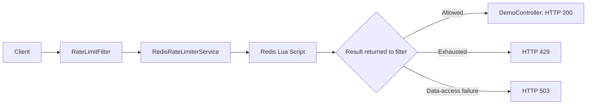

# Distributed API Rate Limiter

A Java and Spring Boot application that limits API requests using the Token Bucket algorithm. Redis stores shared client allowances, while an atomic Lua script keeps token updates consistent across multiple application instances.

## Features

- Per-IP rate limiting across multiple application instances.
- Configurable bucket capacity and refill rate.
- Atomic token calculations using Redis Lua scripting.
- Automatic expiration of inactive buckets.
- HTTP `429` responses when an allowance is exhausted.
- HTTP `503` responses when Redis data-access failures prevent validation.
- Startup validation for configuration values.
- 17 automated tests.
- Reproducible load testing with k6.

## Technology

| Component | Technology |
|---|---|
| Language | Java 21 |
| Framework | Spring Boot 4.1.1 |
| Web server | Embedded Apache Tomcat |
| Shared storage | Redis 8 |
| Redis integration | Spring Data Redis and Lettuce |
| Build | Maven Wrapper |
| Testing | JUnit Jupiter, Mockito, Spring Test |
| Load testing | k6 2.3.0 |
| Local infrastructure | Docker Compose |

## Architecture



Each application instance connects to the same Redis server. Requests from the same client IP therefore share one allowance, regardless of which instance handles them.

The filter protects paths beginning with `/api/`.

## How the Token Bucket Works

Each client has a bucket with:

- **Capacity:** maximum number of tokens.
- **Refill rate:** tokens replenished per second.
- **Token balance:** remaining allowance.
- **Last refill timestamp:** time of the latest calculation.

Each request costs one token.

With the default configuration, a client can make an initial burst of 10 requests. Tokens then replenish at one token per second.

The refill calculation is:

```text
elapsedSeconds = (nowMs - lastRefillMs) / 1000

tokens = min(
    capacity,
    tokens + elapsedSeconds * refillTokensPerSecond
)
```

Refilling is calculated when a request arrives; no background timer is required.

### Atomic Redis Updates

The Lua script performs the following steps atomically:

1. Read Redis server time.
2. Load the client's bucket, or initialize a full bucket.
3. Calculate the refill, capped at capacity.
4. Consume one token if available.
5. Save the updated state and refresh its expiry.
6. Return `1` for allowed or `0` for rejected.

Redis server time provides a common clock across application instances. The script also prevents negative elapsed time if the clock moves backward.

### Redis Storage

Each bucket is stored as a hash:

```text
Key: rate-limiter:<client-ip>

Fields:
  tokens
  last_refill_ms
```

Inactive buckets expire using:

```text
TTL seconds = max(1, ceil(capacity / refillRate) * 2)
```

With capacity 10 and refill rate 1, the expiry is 20 seconds. By then, an inactive bucket would already have refilled completely.

Expiry is refreshed on both allowed and rejected requests.

## Prerequisites

- JDK 21.
- Docker Desktop with the engine running.
- Docker Compose.
- Ports 8080 and 6379 available.
- Port 8081 available for the optional second instance.

The commands below use **Windows PowerShell** and should be executed from the project root.

## Getting Started

### 1. Start Redis

```powershell
docker compose up -d
docker compose exec redis redis-cli ping
```

Expected response:

```text
PONG
```

### 2. Start the Application

If necessary, configure `JAVA_HOME` for the current terminal. Adjust the path to match your JDK installation:

```powershell
$env:JAVA_HOME = 'C:\Program Files\Java\jdk-21'
.\mvnw.cmd spring-boot:run
```

Alternatively, run `RateLimiterApplication.main()` in IntelliJ IDEA.

Wait for:

```text
Tomcat started on port 8080
```

Keep the application running while testing requests.

### 3. Call the Endpoint

In another terminal:

```powershell
curl.exe -i http://localhost:8080/api/hello
```

The current demo response is:

```json
{"Message":"Hello, Your request was successfull"}
```

Running the automated tests does not leave an HTTP server running on port 8080.

## Configuration

Settings are defined in `src/main/resources/application.yaml`:

```yaml
rate-limiter:
  capacity: 10
  refill-tokens-per-second: 1

spring:
  application:
    name: rate-limiter
  data:
    redis:
      host: 127.0.0.1
      port: 6379
      connect-timeout: 2s
      timeout: 2s
```

| Setting | Description |
|---|---|
| `capacity` | Maximum tokens and initial burst allowance. |
| `refill-tokens-per-second` | Tokens replenished per second. |
| `connect-timeout` | Redis connection timeout. |
| `timeout` | Redis read timeout. |

Capacity and refill rate must be positive integers. Invalid configured values cause startup validation to fail.

Java defaults of 10 and 1 apply if those rate-limit settings are omitted. Restart the application after configuration changes.

Instances sharing Redis keys should use the same rate-limit configuration.

## HTTP Responses

| Condition | Status |
|---|---|
| Token available | `200 OK` |
| Allowance exhausted | `429 Too Many Requests` |
| Redis data-access failure | `503 Service Unavailable` |

### Rate Limit Exceeded

Includes `Retry-After: 1`.

```json
{"error":"Too many requests. Try again shortly."}
```

### Limiter Unavailable

```json
{"error":"Rate limiter unavailable. Try again later."}
```

Redis failures use **fail-closed behavior**: the filter stops the request when it cannot check the allowance.

The retry header is a fixed conservative delay for the supported positive-integer refill rates, rather than an exact calculated retry time.

## Automated Tests

Keep Redis running, then execute:

```powershell
.\mvnw.cmd test
```

Verified result:

```text
Tests run: 17, Failures: 0, Errors: 0, Skipped: 0
BUILD SUCCESS
```

| Test class | Tests | Coverage |
|---|---:|---|
| `TokenBucketTest` | 8 | Initial allowance, invalid arguments, exhaustion, refill, fractional tokens, capacity ceiling, concurrency. |
| `RateLimiterServiceTest` | 1 | Separate initial allowances for different clients. |
| `RedisRateLimiterServiceTest` | 3 | Saved token balance, rejection with a future timestamp, refill capped at capacity. |
| `RateLimitFilterTest` | 3 | Forwarding, HTTP 429, HTTP 503, and exactly one service call. |
| `RedisConnectionTest` | 1 | Live Redis connectivity. |
| `RateLimiterApplicationTests` | 1 | Spring application context startup. |

Java bucket tests use an injected clock to control elapsed time.

Redis integration tests use unique client IDs and clean up their own keys. They require a running Redis server.

Filter tests use Mockito and mock servlet requests. The simulated outage deliberately produces a logged exception even when its test passes.

## Verify Distributed Behavior

Keep the first application instance running on port 8080.

Start a second instance from another project-root terminal:

```powershell
$env:JAVA_HOME = 'C:\Program Files\Java\jdk-21'
.\mvnw.cmd spring-boot:run "-Dspring-boot.run.arguments=--server.port=8081"
```

After startup, run this in a third project-root terminal:

```powershell
docker compose exec redis redis-cli DEL "rate-limiter:127.0.0.1"

1..20 | ForEach-Object {
    $rateTestPort = if ($_ % 2 -eq 0) { 8081 } else { 8080 }

    curl.exe -s -o NUL -w "Port $rateTestPort -> %{http_code}\n" "http://127.0.0.1:$rateTestPort/api/hello"
}
```

Requests alternate between both instances while using the same client IP.

Expect approximately 10 successful requests total, followed by `429` responses on both ports. Refilling during execution can allow additional requests.

The manually verified run produced **11 successes and 9 rejections**, demonstrating a shared allowance across both instances.

## Verify Redis Outage and Recovery

Keep the Java application running throughout this check.

After confirming an HTTP 200 response, stop Redis:

```powershell
docker compose stop redis
curl.exe -i http://localhost:8080/api/hello
```

Expected response: **HTTP 503**.

Restore Redis:

```powershell
docker compose start redis
docker compose exec redis redis-cli ping
```

Retry after the connection recovers:

```powershell
curl.exe -i http://localhost:8080/api/hello
```

The manually verified sequence was:

```text
Redis available   -> HTTP 200
Redis unavailable -> HTTP 503
Redis restored    -> HTTP 200
```

Recovery did not require restarting the application.

## Load Testing

The script is located at `load-tests/rate-limiter.js`.

Keep Redis and the application on port 8080 running. Stop any active Redis `MONITOR` session before measuring.

```powershell
Get-Content -Raw .\load-tests\rate-limiter.js | docker run --rm -i grafana/k6:2.3.0 run -
```

The script uses:

- 10 virtual users.
- A 30-second duration.
- A 100 ms pause after each request.
- A 5-second request timeout.
- A threshold requiring zero unexpected responses.

Docker reaches the application through `host.docker.internal`. The virtual users share the container's source IP and compete for one bucket.

HTTP 200 and 429 are expected. Other statuses and transport failures are counted as unexpected.

### Recorded Local Results

Latest successful run, recorded on **26 October 2026**, with capacity 10 and refill rate 1:

| Metric | Result |
|---|---:|
| Total requests | 2,812 |
| Allowed requests | 39 |
| Rejected requests | 2,773 |
| Unexpected failures | 0 |
| Observed request rate | 93.50 requests/second |
| Average HTTP response time | 6.00 ms |
| Median HTTP response time | 4.35 ms |
| p95 HTTP response time | 13.85 ms |
| Maximum HTTP response time | 74.72 ms |

Two consecutive 30-second verification runs completed with zero unexpected responses.

These measurements describe a local Windows/Docker Desktop workload. Hardware specifications were not recorded.

The request rate is **observed throughput under this workload**, not maximum application capacity. Response times include both allowed and rejected requests; most requests were rejected before reaching the controller.

The two-instance sharing demonstration was performed separately from this single-instance load benchmark.

## Main Files

| File | Responsibility |
|---|---|
| `RateLimiterApplication.java` | Application entry point. |
| `RateLimitProperties.java` | Configuration binding and validation. |
| `DemoController.java` | Sample protected REST endpoint. |
| `RateLimitFilter.java` | Request interception and HTTP decisions. |
| `RedisRateLimiterService.java` | Executes the Redis script. |
| `token_bucket.lua` | Atomic shared token-bucket calculation. |
| `TokenBucket.java` | In-memory token-bucket implementation. |
| `RateLimiterService.java` | Retained in-memory service prototype. |
| `compose.yaml` | Local Redis container configuration. |
| `load-tests/rate-limiter.js` | k6 workload and metrics. |

## Design Boundaries

- Client identity uses `getRemoteAddr()`. Clients behind the same NAT or proxy can share an allowance. Trusted forwarded-header handling and authenticated user/API-key identity are not implemented.
- IPv4 and IPv6 address representations produce separate keys.
- An IP shares one allowance across protected paths; per-route policies and variable request costs are not implemented.
- The local deployment uses a single Redis instance without high availability or a durable quota-state guarantee.
- Redis is published only on loopback. Authentication, TLS, and an explicit persistent volume are not configured.
- The HTTP filter uses the Redis service. The retained in-memory service currently creates buckets with fixed values of 10 and 1 and has no idle-bucket eviction. It is not an automatic fallback.
- Redis script cases have integration tests. Cross-instance sharing and outage recovery were verified manually.

## Shutdown

Stop Java application processes using Ctrl+C in their terminals or IntelliJ's Stop action.

Stop Redis while retaining its container:

```powershell
docker compose stop redis
```

Remove the project's Compose container and network:

```powershell
docker compose down
```